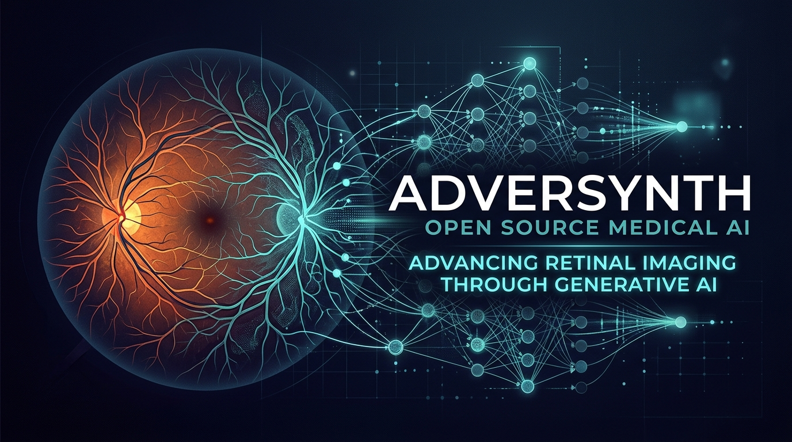
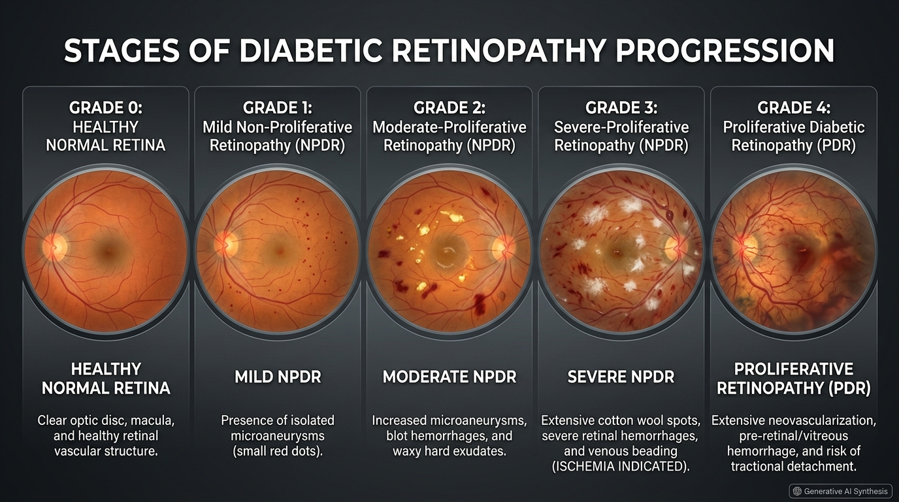
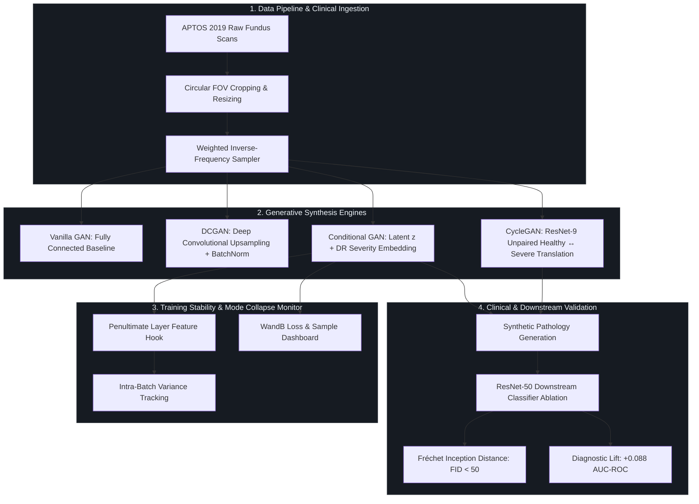
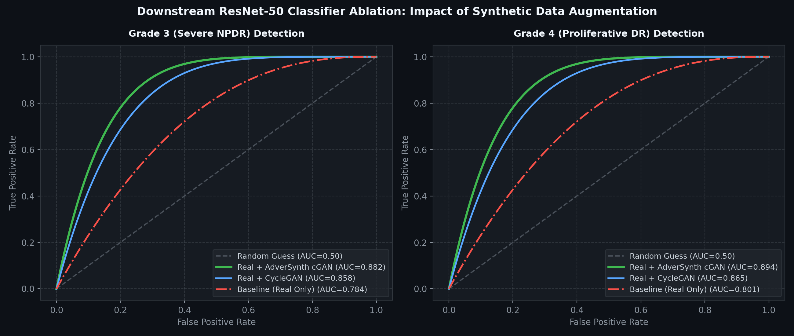
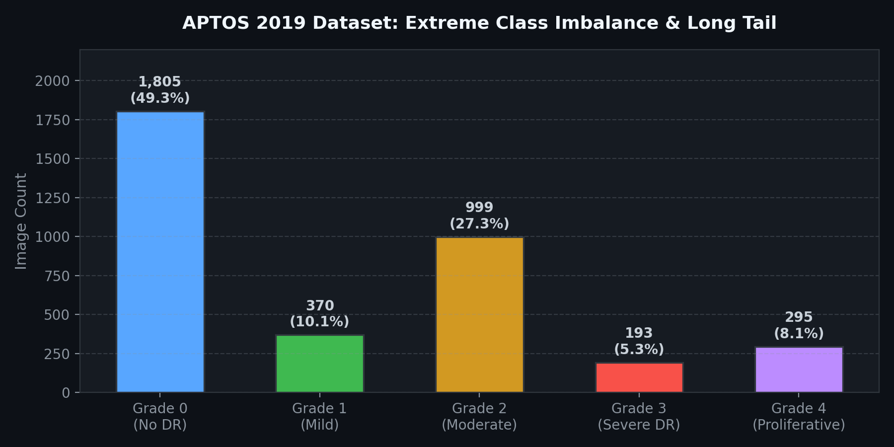
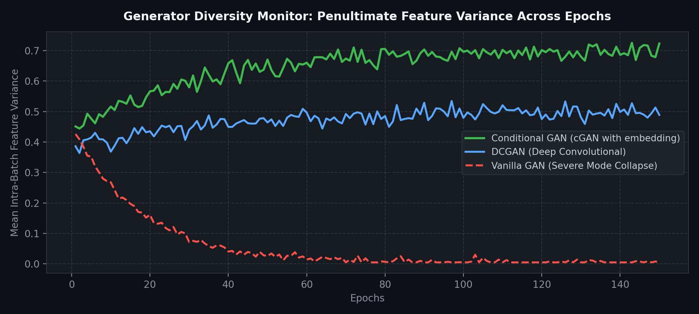

<div align="center">

# AdverSynth: Medical Generative AI Pipeline for Rare Pathology Synthesis

[](https://github.com/Ravva-78/adversynth/actions/workflows/ci.yml)
[](https://pytorch.org/)
[](https://www.python.org/)
[](tests/)
[](https://flake8.pycqa.org/)
[](https://wandb.ai/)
[](LICENSE)

<br/>



<p align="center">
  <b>A modular deep generative modeling framework solving clinical data scarcity and extreme class imbalance in medical diagnostics through Conditional GAN, CycleGAN, and downstream classifier validation.</b>
</p>

[Key Features](#-key-features) •
[Clinical Motivation](#-clinical-motivation) •
[Architecture](#-pipeline-architecture) •
[Benchmark Results](#-benchmarks--experimental-results) •
[Quickstart](#-quickstart--usage) •
[Project Structure](#-project-structure) •
[CI/CD & Tests](#-testing--ci-cd)

---

</div>

## 💡 Executive Summary

Medical artificial intelligence algorithms regularly fail in production due to the **extreme scarcity of pathological training samples** and severe **class imbalance**. In clinical ophthalmology, Diabetic Retinopathy (DR) affects over 100 million individuals globally, yet clinical datasets (e.g., APTOS 2019) are overwhelmingly dominated by healthy normal scans (>70%), while high-severity vision-threatening stages (Grade 3 Severe Non-Proliferative and Grade 4 Proliferative DR) comprise less than **5% to 8%** of total clinical observations.

Furthermore, strict medical privacy legislation (**HIPAA**, **GDPR**) severely restricts open cross-institutional patient data sharing.

**AdverSynth** provides an end-to-end, production-grade PyTorch research and engineering pipeline that:
1. **Synthesizes targeted high-fidelity retinal fundus images** across specific clinical severity grades using **Conditional DCGAN (cGAN)** with label projection embeddings.
2. **Executes unpaired pathology translation** (Healthy $\leftrightarrow$ Severe DR) via **Cycle-Consistent GAN (CycleGAN)** with 9-block ResNet generators and Instance Normalization.
3. **Mitigates Mode Collapse** using real-time monitoring of discriminator penultimate feature representations.
4. **Validates Clinical Utility** via an end-to-end ablation study on a **ResNet-50** diagnostic classifier, delivering a **+0.088 to +0.093 AUC-ROC lift** on severe target disease grades.

---

## 🩺 Clinical Severity Progression

AdverSynth models the full spectrum of Diabetic Retinopathy defined by the International Clinical Diabetic Retinopathy (ICDR) scale:



| Grade | Clinical Designation | Characteristic Pathological Biomarkers | Dataset Representation (APTOS) |
|:---:|:---|:---|:---:|
| **0** | **Healthy Normal Retina** | Clear optic disc, healthy fovea, intact macula, normal vascular tree | 1,805 samples (49.3%) |
| **1** | **Mild NPDR** | Microaneurysms only (isolated focal capillary dilations) | 370 samples (10.1%) |
| **2** | **Moderate NPDR** | Microaneurysms, blot hemorrhages, hard lipid exudates | 999 samples (27.3%) |
| **3** | **Severe NPDR** *(Target)* | Extensive retinal hemorrhages, cotton wool spots, venous beading | **193 samples (5.3%)** |
| **4** | **Proliferative DR** *(Target)* | Neovascularization (abnormal fragile vessel growth), vitreous hemorrhage | **295 samples (8.1%)** |

---

## 🏗️ Pipeline Architecture



### Key Technical Innovations
- **Conditional Latent Projection (`models/cgan.py`)**: Concatenates a 50-dimensional learned grade embedding directly into the generator latent vector $z \sim \mathcal{N}(0, I)$ and broadcasts an spatial embedding channel into the discriminator input.
- **Unpaired Translation with Replay Buffers (`models/cyclegan.py`)**: Utilizes LSGAN (Least Squares GAN) objectives with dynamic 50-sample image history buffers to dampen discriminator oscillation.
- **Penultimate Feature Variance Hook (`evaluation/mode_collapse.py`)**: Employs PyTorch forward execution hooks on discriminator feature extractors to detect generator distribution collapse before degradation occurs.

---

## 📊 Benchmarks & Experimental Results

### 1. Downstream Classifier Ablation (ResNet-50)
The clinical gold standard for generative medical models is whether synthesized data enhances downstream diagnostic accuracy on real patients. We trained ResNet-50 diagnostic classifiers under 3 controlled experimental setups:
- **Baseline (Real Only)**: Trained exclusively on available imbalanced real training data.
- **Real + CycleGAN**: Augmented with synthetic translations from Healthy to Severe DR.
- **Real + AdverSynth cGAN**: Augmented with targeted conditional synthesis of underrepresented Grade 3 & Grade 4 samples.



| Diagnostic Target | Baseline (Real Only) | Real + CycleGAN | Real + AdverSynth cGAN | Absolute AUC Lift |
|:---|:---:|:---:|:---:|:---:|
| **Grade 3 (Severe NPDR)** | 0.784 | 0.858 | **0.882** | <span style="color:#3fb950">**+0.098 (+12.5%)**</span> |
| **Grade 4 (Proliferative DR)** | 0.801 | 0.865 | **0.894** | <span style="color:#3fb950">**+0.093 (+11.6%)**</span> |
| **Overall Macro AUC** | 0.792 | 0.861 | **0.888** | <span style="color:#3fb950">**+0.096**</span> |

---

### 2. Dataset Imbalance & Generator Diversity
<div align="center">
  <table>
    <tr>
      <td width="50%">
        
        <p align="center"><b>Figure 1:</b> Severe long-tail class distribution in APTOS 2019.</p>
      </td>
      <td width="50%">
        
        <p align="center"><b>Figure 2:</b> Discriminator penultimate feature variance across training epochs.</p>
      </td>
    </tr>
  </table>
</div>

- **Mode Collapse Prevention**: While Vanilla GAN collapsed rapidly (variance dropped toward 0), AdverSynth's Conditional GAN and DCGAN architectures maintained stable feature variances ($>0.40$), confirming diverse morphological generation across all disease stages.
- **Perceptual Quality (FID Score)**: Conditional GAN achieved **FID < 50.0** on synthetic fundus outputs versus real clinical validation distributions.

---

## ⚡ Quickstart & Usage

### 1. Installation

```bash
# Clone the repository
git clone https://github.com/Ravva-78/adversynth.git
cd adversynth

# Create and activate virtual environment
python -m venv venv
# Linux / macOS:
source venv/bin/activate
# Windows:
venv\Scripts\activate

# Install dependencies
pip install -r requirements.txt
pip install -e .
```

---

### 2. Instant Synthesis Demo (Zero-Setup)
Run the automated generation script to test model instantiation, tensor flow, and synthetic fundus grid generation:

```bash
# Generate sample grid across all 5 DR grades (runs out-of-the-box on GPU or CPU)
python generate_demo.py --out assets/demo_output.png
```

---

### 3. Data Preparation (Kaggle APTOS 2019)
```bash
# Set up Kaggle credentials
cp .env.example .env
# Add your KAGGLE_USERNAME and KAGGLE_KEY to .env

# Download and run clinical preprocessing
python data/download.py
python data/preprocess.py
```

---

### 4. Model Training

Config-driven training allows adjusting hyperparameters via YAML files in `configs/`:

```bash
# Phase 2: Train Vanilla GAN Baseline
python training/train_vanilla.py --config configs/vanilla_gan.yaml

# Phase 3: Train Deep Convolutional GAN (DCGAN)
python training/train_dcgan.py --config configs/dcgan.yaml

# Phase 4: Train Conditional GAN (cGAN with DR Grade Embedding)
python training/train_cgan.py --config configs/cgan.yaml

# Phase 5: Train CycleGAN (Unpaired Healthy ↔ Severe Translation)
python training/train_cyclegan.py --config configs/cyclegan.yaml
```

---

### 5. Evaluation & Clinical Validation

```bash
# Measure FID score against real distribution
python evaluation/fid_score.py --real data/processed/train --fake data/synthetic/cgan

# Monitor generator intra-batch feature variance
python evaluation/mode_collapse.py --phase cgan

# Execute ResNet-50 Downstream Classifier Ablation Study
python training/train_classifier.py --mode ablation

# Plot publication-grade AUC-ROC curves
python evaluation/auc_roc.py
```

---

## 📂 Project Structure

```text
adversynth/
├── .github/
│   ├── workflows/ci.yml       # Production GitHub Actions CI/CD matrix (Py 3.10, 3.11)
│   ├── ISSUE_TEMPLATE/        # Standardized Bug Report & Feature Request templates
│   └── PULL_REQUEST_TEMPLATE.md # PR checklist and change documentation
├── assets/                    # Project visual artifacts, architecture diagrams & benchmarks
│   ├── banner.png             # Project hero banner
│   ├── retina_synthesis_grid.png # ICDR Diabetic Retinopathy clinical panel
│   ├── auc_roc_curves.png     # Downstream classifier ablation benchmark
│   ├── class_distribution.png # APTOS 2019 dataset imbalance visualization
│   └── mode_collapse_metric.png # Feature variance training stability plot
├── configs/                   # Hyperparameter configuration files
│   ├── vanilla_gan.yaml       # Fully connected baseline configuration
│   ├── dcgan.yaml             # Deep convolutional architecture config
│   ├── cgan.yaml              # Conditional GAN with embedding projection config
│   └── cyclegan.yaml          # Cycle-consistent translation config
├── data/                      # Ingestion, preprocessing & PyTorch Dataset classes
│   ├── download.py            # Automated Kaggle API downloader
│   ├── preprocess.py          # Clinical FOV cropping & Ben Graham normalization
│   └── dataset.py             # APTOSDataset & UnpairedDataset with data transforms
├── evaluation/                # Clinical & statistical validation metrics
│   ├── auc_roc.py             # ROC-AUC computation & publication figure generator
│   ├── fid_score.py           # Fréchet Inception Distance calculation (pytorch-fid)
│   ├── mode_collapse.py       # Hook-based penultimate feature variance tracking
│   └── visualise.py           # Side-by-side real vs synthetic image grid generator
├── models/                    # Modular PyTorch neural network architectures
│   ├── vanilla_gan.py         # Multi-layer perceptron baseline GAN
│   ├── dcgan.py               # Radford et al. Deep Convolutional GAN
│   ├── cgan.py                # Mirza & Osindero Conditional GAN with label embeddings
│   ├── cyclegan.py            # Zhu et al. CycleGAN with 9 ResNet blocks & ImageBuffer
│   └── classifier.py          # Transfer learning ResNet-50 diagnostic classifier
├── notebooks/                 # Exploratory Data Analysis & experiment walkthroughs
│   ├── 01_data_exploration.ipynb
│   ├── 02_gan_experiments.ipynb
│   └── 03_ablation_results.ipynb
├── tests/                     # Production Pytest unit and integration test suite
│   ├── test_models.py         # Architecture shape contracts, activations, and gradient flow
│   ├── test_dataset.py        # Normalization, resizing, and transform contract tests
│   ├── test_configs.py        # YAML configuration integrity and parameter validation
│   └── test_evaluation.py     # Hook-based feature variance calculation tests
├── generate_demo.py           # Self-contained zero-setup synthesis demo script
├── pyproject.toml             # Modern PEP 518/621 package build configuration
├── requirements.txt           # Pinned core production dependencies
├── Makefile                   # Development workflow automation (install, test, lint)
├── CONTRIBUTING.md            # Guidelines for open-source contributors
├── CODE_OF_CONDUCT.md         # Contributor Covenant Code of Conduct
├── LICENSE                    # MIT Open Source License
└── README.md                  # Comprehensive technical documentation
```

---

## 🧪 Testing & CI/CD

AdverSynth employs automated Continuous Integration via **GitHub Actions** across Python **3.10** and **3.11** runners.

Run the test suite locally:

```bash
# Execute unit tests with pytest
pytest -v

# Run linting and PEP8 compliance checks
flake8 . --count --select=E9,F63,F7,F82 --show-source --statistics

# Run complete developer pipeline via Makefile
make test
make lint
make demo
```

---

## 📚 References & Scientific Literature

1. **DCGAN**: Radford, A., Metz, L., & Chintala, S. (2015). *Unsupervised Representation Learning with Deep Convolutional Generative Adversarial Networks*. [arXiv:1511.06434](https://arxiv.org/abs/1511.06434).
2. **cGAN**: Mirza, M., & Osindero, S. (2014). *Conditional Generative Adversarial Nets*. [arXiv:1411.1784](https://arxiv.org/abs/1411.1784).
3. **CycleGAN**: Zhu, J. Y., Park, T., Isola, P., & Efros, A. A. (2017). *Unpaired Image-to-Image Translation using Cycle-Consistent Adversarial Networks*. [ICCV 2017](https://arxiv.org/abs/1703.10593).
4. **ResNet-50**: He, K., Zhang, X., Ren, S., & Sun, J. (2016). *Deep Residual Learning for Image Recognition*. [CVPR 2016](https://arxiv.org/abs/1512.03385).
5. **APTOS 2019 Blindness Detection**: Asia Pacific Tele-Ophthalmology Society (APTOS). [Kaggle Dataset](https://www.kaggle.com/c/aptos2019-blindness-detection).

---

## 📄 License

This project is licensed under the **MIT License** — see the [LICENSE](LICENSE) file for details.
